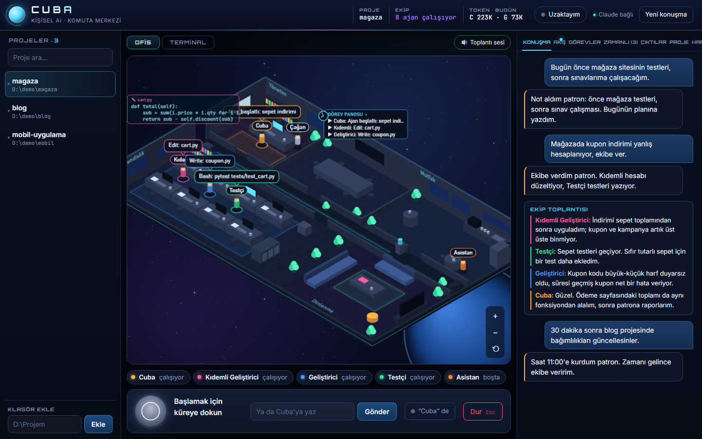
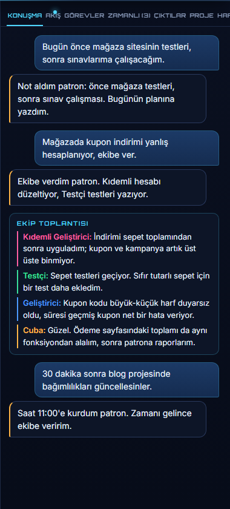
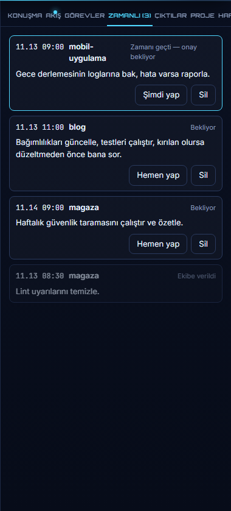

# Cuba — kişisel AI komuta merkezi

Türkçe konuşan, eller serbest kişisel asistan ve ona bağlı bir yazılım ekibi.
Sen **Cuba**'yla konuşursun (sesle, yazıyla ya da Telegram'dan); Cuba gününü, planını ve
notlarını tutar, kod işlerini her projenin kendi terminalindeki Claude Code ekibine verir
ve sonucu sana anlatır. Ekip ekranda gerçek bir ofiste çalışır: kim ne yazıyor, kim kiminle
konuşuyor, canlı görürsün.



| Konuşma ve ekip toplantısı | Zamanlı işler |
|---|---|
|  |  |

> Görüntüler örnek verilerle `tools\screenshots.py` ile alınır; gerçek konuşma ya da hafıza içermez.

## Başlatma

- Masaüstündeki **Claude Ses** kısayoluna çift tıkla (ya da `start.cmd`).
  Ses tanıma modeli yüklenince tarayıcıda `http://127.0.0.1:8765` açılır.
- **Küreye dokun** ve konuş; Cuba sesle cevap verir. Ya da alttaki kutuya yaz.
- **Dur** düğmesi ya da `Esc` her şeyi durdurur.
- **Yeni konuşma** sohbet geçmişini sıfırlar; plan, not ve hafıza kalır.
- Kapatmak için küçültülmüş "Claude Ses" komut penceresini kapat; terminaller de onunla kapanır.

Kısayol silinirse: `powershell -ExecutionPolicy Bypass -File D:\ClaudeSes\tools\make_shortcut.ps1`

## Cuba

Cuba, Gemini Live üzerinde çalışan sesli asistandır ve ekibin takım lideridir. Kendinden emin
bir müdür gibi konuşur, sana "patron" der, kendi fikrini söyler. Yaptıkları:

- **Gününü tutar.** "Bugün önce ASP Rubber testleri, sonra sınavlara çalışacağım" dersen
  `bugun.md`'ye tarihli, sıralı bir plan yazar ve biteni işaretler. Bilgisayarı kapatıp
  açsan da bugün konuşulanların son kısmı ve plan her bağlanışta önüne gelir; ertesi gün
  yarım kalanları sorar.
- **Hafıza tutar.** Senin hakkında öğrendiklerini `cagan.md`'ye, görev, takvim ve notları
  kendi dosyalarına yazar; her gün bitince günlük sayfasını yazar.
- **Ekibe iş verir.** Kod, proje ya da dosya işini ilgili projenin terminaline verir;
  rapor gelince sana bir iki cümleyle anlatır.
- **İleri zamana iş kurar.** "30 dakika sonra blog'da bağımlılıkları güncellesinler" →
  bkz. [Zamanlı işler](#zamanlı-işler).
- **Günlük hayat:** spor, yol, yemek, uyku kayıtları; "araçtayım", "uyuyorum" gibi durumlar;
  hava durumu ve Google araması.
- **Ekibi büyütür:** "Cuba, bir tasarımcı işe al" dersen yeni bir uzman alınır.

Sesle, yazıyla ya da Telegram'dan konuştuğun hep aynı Cuba'dır: aynı araçlar, aynı hafıza.
Sesini Hafıza sekmesindeki **Cuba'nın sesi** listesinden seçersin (varsayılan Algenib).

## Ekip

Her projenin kendi terminali vardır ve orada bir Claude Code oturumu Cuba olarak çalışır.
Ekip üyeleri o oturumun alt ajanlarıdır (`cuba-ekip:<kimlik>`):

| Üye | Model | İş |
|---|---|---|
| Kıdemli Geliştirici | Opus | Zor işler: mimari, karmaşık hatalar, çok dosyalı değişiklikler |
| Geliştirici | Sonnet | Orta işler: tek özellik, bilinen kalıpta kod |
| Testçi | Sonnet | Test yazar, çalıştırır, değişiklikleri inceler |
| Asistan | Haiku | Basit işler: arama, yeniden adlandırma, doküman |
| İşe alınanlar | seçilen | Tasarımcı, güvenlikçi… (en fazla dört; `data\ekip.json`) |

- **Token tasarrufu önce gelir.** Terminaldeki Cuba küçük işleri kendisi yapar; ekibi yalnızca
  iş büyükse, paralel bölünebiliyorsa ya da uzmanlık gerekiyorsa çalıştırır ve işi yapabilecek
  en ucuz üyeye verir. Bu yüzden basit işlerde masalar boş görünür; bu bilinçli bir tercih.
- **Paralel projeler:** "BalBal'a şunu ekle" deyip ardından "Portfolyo'da şuna bak" dersen iki
  terminal aynı anda çalışır. Çalışan projelerin noktası listede yanıp söner.
- **Toplantılar:** bir işi iki ya da daha fazla üye yaptıysa ekip iş bitince toplanır. Toplantı
  Gemini'de yazılır (Claude token'ı harcamaz), her üye kendi sesiyle konuşur; kararlar
  konuşmaya ve panoya düşer, önerilen işleri Cuba sana sorar.
- **Riskli işler** (silme, `git push`, proje dışına yazma) için ekip durup sorar; onay sesle,
  ekrandan ya da Telegram'daki Evet/Hayır düğmesiyle verilir.
- Ekip tüzüğü `data\terminal\TERMINAL.md`, Cuba'nın sesli talimatı `ekip\CANLI.md`'dedir.

## Ofis ve pano

- **Ofis (orta):** çalışan masasında, toplantıdaki toplantı odasında, işini bitiren mutfakta
  görünür. Kod yazan üyenin masasının üstünde yazdığı kod hologram olarak akar. Birine
  tıklayınca görevi ve son yaptıkları açılır. **Terminal** sekmesi aynı projenin ham
  Claude Code ekranıdır.
- **Sağ pano:** Konuşma, Akış (kim ne yapıyor, canlı), Görevler, **Zamanlı**, Çıktılar
  (biten işlerin raporları), Proje, Hafıza.
- Ofiste yazıcıya, panoya, saate, kitaplığa ve toplantı masasına tıklayarak ilgili sekmeyi
  açabilirsin. Başlıktaki **Token · bugün** bugün harcanan Claude ve Gemini token'ını gösterir.

## Zamanlı işler

Cuba'ya "30 dakika sonra…", "saat 15:00'te…", "yarın 09:00'da…" dersen iş kaydedilir ve
zamanı gelince o projenin terminaline, sen vermişsin gibi yazılır. Bekleme sırasında hiç
token harcanmaz.

- **Zamanlı** sekmesinde bekleyenler en yakını üstte görünür; her birini **Hemen yap** ya da
  **Sil** düğmesiyle yönetirsin. Cuba'ya "zamanlı işleri say", "3 numarayı sil" de diyebilirsin.
- **Zamanı geçen iş kendiliğinden yapılmaz.** Sunucu kapalıyken zamanı kaçan iş "Zamanı geçti —
  onay bekliyor" olur; Cuba sesli konuşmadaysa sana sorar, değilse soru Telegram'a gelir.
- Kayıtlar: `data\zamanli.json`.

## Ayarlar — `config.json` (isteğe bağlı)

```json
{
  "voice": "tr-TR-EmelNeural",
  "vocabulary": ["Çağan", "Claude", "WordPress", "Nevka Kağıt", "Telsiz Mağaza", "BalBal Medya"],
  "whisper_model": "large-v3-turbo",
  "workdir": "D:\\",
  "port": 8765,
  "models": { "kidemli": "claude-opus-5-5" }
}
```

Yalnızca değiştirmek istediğin alanları yaz. `models` içinde `lider`, `kidemli`,
`gelistirici`, `testci`, `asistan` için model seçebilirsin. `vocabulary`, ses tanımanın doğru yazmasını
istediğin özel isimlerdir (müşteriler, siteler, kişiler). Erkek ses için `tr-TR-AhmetNeural`.
Değişiklikten sonra uygulamayı kapatıp aç.

## Asistanın hafızası — `asistan\`

| Dosya | İçerik |
|---|---|
| `ASISTAN.md` | Asistanın kuralları ve kişiliği (düzenleyebilirsin) |
| `cagan.md` | Cuba'nın senin hakkında öğrendikleri, bölüm bölüm (Tercihler, Projeler, İnsanlar…) |
| `bugun.md` | Bugünün planı: ilk satır tarih, altında sıralı maddeler |
| `gunluk\YYYY-MM-DD.md` | Her günün günlüğü: ne istendi, ne yapıldı, ne yarım kaldı |
| `gorevler.md` | Görevler (`- [ ]` / `- [x]`) |
| `takvim.md` | `## YYYY-MM-DD` altında randevular |
| `notlar.md` | Notlar |
| `hatirlatmalar.json` | Hatırlatma kayıtları |

Hepsi düz metin; elle de düzenleyebilirsin — en kolayı panodaki **Hafıza** sekmesi.

Cuba'yla her konuşma (sesli ya da Telegram) `data\konusmalar\` altına günlük olarak yazılır.
Gün bitince Cuba o günün günlüğünü yazar, senin hakkında yeni öğrendiklerini `cagan.md`'nin
uygun bölümüne ekler (hiçbir şeyi silmez) ve ertesi gün konuşmaya dünün sayfasını hatırlayarak başlar.
Gün içinde yeniden bağlanınca (bilgisayar kapanıp açılsa da) bugünkü konuşmanın son kısmı da Cuba'ya verilir.
Hafıza sekmesindeki **Bugünü şimdi yaz** günü beklemeden yazdırır.

## "Cuba" de, dinlesin

Ses panelindeki **“Cuba” de** düğmesini açarsan küreye dokunmana gerek kalmaz: "Cuba" demen
yeterli; iPhone'da ana ekran uygulamasında da çalışır. Ad bilgisayardaki Whisper ile tanınır,
bekleme sırasında ses dışarı çıkmaz; düğme ne duyduğunu gösterir. Bir buçuk dakika kimse
konuşmazsa uykuya döner.

## Telefondan

**Canlı konuşma (Tailscale).** Bilgisayar evde açık kalır, telefon mikrofon ve hoparlör olur.

1. Bilgisayara ve telefona [Tailscale](https://tailscale.com/download) kur, ikisinde de aynı hesapla gir.
2. Bilgisayarda bir kez: `tailscale serve --bg 8765`
3. Cuba'yı yeniden başlat; pencerede `Telefondan: https://<bilgisayar>.<ağ>.ts.net` yazar.
4. Telefonda o adresi Chrome/Safari ile aç, **Ana ekrana ekle** de. Küreye dokun, konuş.

Adres yalnızca senin Tailscale cihazlarından açılır; internete açık değildir. Tailscale adı
kendiliğinden bulunmazsa `config.json`'a `"remote_hosts": ["pc.agin.ts.net"]` yaz.

**Telegram (yazı, sesli mesaj, bildirim, onay).**

1. Telegram'da @BotFather'a `/newbot` yaz, verdiği token'ı al.
2. `data\telegram.json` dosyası oluştur: `{"token": "123456:ABC..."}`
3. Cuba'yı yeniden başlat. Pencerede ve sayfada bir eşleme kodu çıkar; bota `/esle <kod>` yaz.

Bundan sonra bot yalnızca sana cevap verir. Yazabilir ya da sesli mesaj atabilirsin; Cuba
aynı araçlarla iş verir. Sen ekran başında değilken (ya da uzak moddayken) biten işler,
toplantı kararları ve **Evet/Hayır düğmeli** onay soruları telefonuna gelir.
Komutlar: `/durum`, `/uzak` (uzak modu aç-kapa), `/dur` (terminali durdur).

## Hatırlatmalar

Asistan "yarın saat üçte X'i hatırlat" deyince Windows Görev Zamanlayıcı'da
`\ClaudeSes\` altında tek seferlik bir görev kurar. Zamanı gelince bildirim çıkar ve
sesli okunur — uygulama kapalı olsa bile (bilgisayar ve oturum açık olmalı; bilgisayar
o saatte kapalıysa açılınca gelir).

```powershell
D:\ClaudeSes\.venv\Scripts\python.exe D:\ClaudeSes\tools\reminder.py list
D:\ClaudeSes\.venv\Scripts\python.exe D:\ClaudeSes\tools\reminder.py delete <id>
```

## Gizlilik

- Canlı konuşmada (varsayılan) sesin Gemini Live'a (Google) gider; klasik modda ses
  bilgisayardan çıkmaz, yazıya dökme yerel Whisper ile yapılır.
- Cuba'nın hafıza dosyaları, günlükler ve Telegram mesajları Gemini'ye gider; ekibe verilen
  işler ve projen Claude'a (Anthropic) gider.
- Seslendirilen yanıtlar ve hatırlatmalar Microsoft Edge seslendirme hizmetine gider
  (resmi olmayan erişim yolu; internet gerekir, ileride çalışmayı bırakabilir).
- Sunucu yalnızca bu bilgisayardan (`127.0.0.1`) ve kurduysan senin Tailscale cihazlarından
  erişilebilir. Ekip araç kurabilir (`pip`, `uv`, `npm`, `npx`, `winget`) ama paket kaldıramaz.
- Ekip **tam yetkiyle** çalışır: Claude süreçleri izin sormadan dosya değiştirip komut
  çalıştırabilir. Plan onayı ve riskli iş sorusu talimatla sağlanır.

## Sorun giderme

| Belirti | Çözüm |
|---|---|
| Kırmızı küre: "Claude Code bulunamadı…" | Bir terminalde `claude` yazıp giriş yap, uygulamayı yeniden aç |
| "Mikrofon izni gerekli" | Adres çubuğundaki kilit simgesinden mikrofona izin ver |
| "Ses tanıma işlemcide çalışıyor" | Ekran kartı kullanılamadı; çalışır ama daha yavaştır. Başka bir uygulama (ör. Ollama) ekran kartı belleğini dolduruyor olabilir |
| Söylediğim algılanmıyor | Windows ses ayarlarında doğru mikrofonun varsayılan olduğundan emin ol |
| "Başka bir sekmede açıldı" | Uygulama yalnızca bir sekmede çalışır; diğer sekmeyi kullan |
| Ses yok, yalnızca yazı | İnternet bağlantısını kontrol et (Edge sesi çevrimiçi) |

Günlükler: `data\remind.log` (hatırlatmalar).

## Geliştirme

```powershell
.venv\Scripts\python -m pytest                     # birim testleri
.venv\Scripts\python -m pytest -m "network or gpu" # gerçek Edge sesi ve ekran kartında Whisper
$env:PLAYWRIGHT_BROWSERS_PATH='D:\ClaudeSes\.pw-browsers'
.venv\Scripts\python -m pytest -m e2e -s           # gerçek Claude ile uçtan uca (uygulama kapalıyken)
.venv\Scripts\python tools\screenshots.py          # README görüntülerini örnek verilerle yeniden al
```
