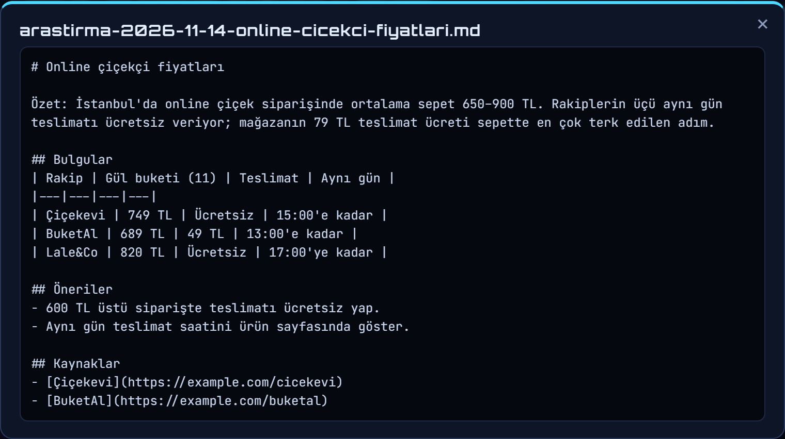
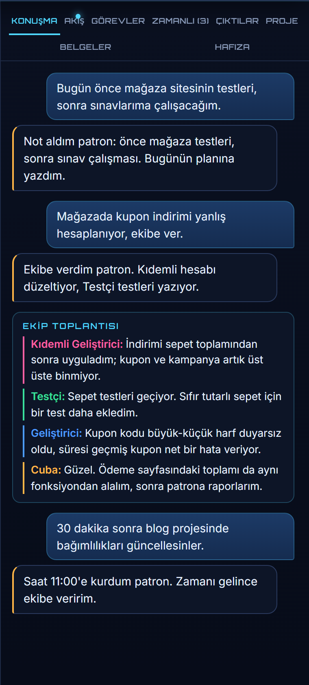
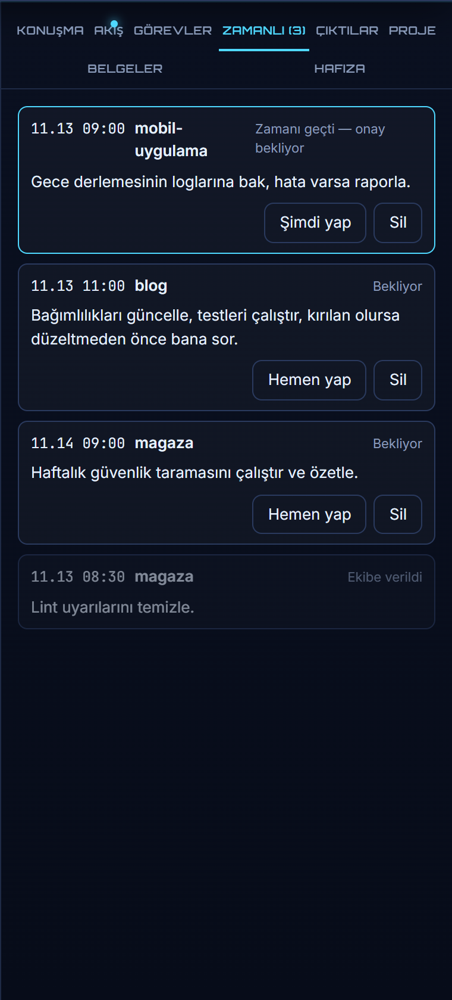
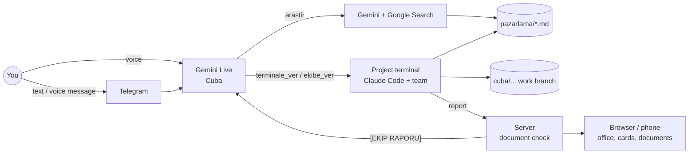

# Cuba: a personal AI command center

Cuba is a Turkish-speaking personal assistant you talk to by voice, and the AI team it manages.

- **Talk runs on Gemini Live:** you speak as if on a phone call, interrupt whenever you like, and answers arrive in about half a second.
- **Work runs on Claude Code:** code, research, marketing and slide decks are done by a Claude team in each project's own terminal.
- **Everything is on screen:** the team works in an office on a space station. You watch live who is writing which file and who is in a meeting with whom.

Everyday chat spends no Claude tokens. Claude only runs when there is real work to do.


| The office, team at work | On the phone |
|---|---|
|  |  |

> Screenshots are taken from made-up data with `tools\screenshots.py`. They contain no real conversations or memory.
> The interface and Cuba's voice are in Turkish; the labels below give the Turkish name in parentheses.

## What it does

**Talks and remembers**
- Keeps your plan for the day, tasks, calendar and notes. Ask "what was on today?" and it remembers.
- Gets to know you: it writes your preferences, projects and dislikes into a notebook and acts on them.
- Writes a diary at the end of each day, and brings up unfinished things the next day on its own.
- Logs everyday life such as workouts, drives, sleep and meals. Searches Google for the weather and current facts.

**Hands out work**
- Say "the coupon discount in the shop is wrong, give it to the team" and it hands the job to that project's terminal and keeps talking with you.
- Code changes happen on a separate work branch (`cuba/...`), not in the project itself. If you don't like the result, say "drop it" and the project is untouched.
- When the team finishes, a report comes in and Cuba tells you about it in a sentence or two.
- Schedules work for later: "in 30 minutes, have them update the blog's dependencies."

**Researches and writes documents**
- Short questions (weather, a score, a price) are answered right away by voice.
- Say "research online florist prices" and Gemini researches it on Google and writes the document into the project's `pazarlama\` (marketing) folder. No Claude tokens are spent.
- Deeper work such as crawling a site, competitor analysis and slide decks (`.pptx`) is done by the marketing team on Claude.
- A finished job's documents appear on its card under the orb. Click one to open it.
- The server checks that every document a report names really exists on disk, so Cuba cannot call a missing document "ready."

**Finds you**
- When you are away from the screen, finished work, meeting decisions and approval questions come to Telegram.
- If the team gets stuck on a step only you can take (a sign-in, 2FA, a UAC prompt), your phone rings with a "Cuba is calling" (Cuba arıyor) notification.
- In away mode Cuba makes the decisions for you. When you return it says "welcome back, boss" and sums up what happened.

| Every project's documents | A research document |
|---|---|
|  |  |

## The team

An office of nine: you, Cuba and two departments.

| Department | Who | What they do |
|---|---|---|
| Management | **Cuba** | Listens to you, splits up the work, hands it out, reports back to you |
| Software | Senior Developer, Developer, Tester, Assistant | Code, architecture, tests, small jobs |
| Marketing | Marketer, Content Writer, Social Media Manager | Strategy, research, copy, SEO, social media, decks |

When needed, Cuba hires a new specialist ("hire a designer"). Up to four new desks can be opened.
When several people worked on a job, they talk it over in the meeting room once it is done. You can listen to the meeting out loud.

| Conversation and team meeting | Scheduled work |
|---|---|
|  |  |

## How it works



- **Server** (`server/`): FastAPI and WebSockets. Runs the Gemini Live session, the project terminals, the office and the memory.
- **Terminal:** every project has its own Windows terminal running Claude Code. Team members are Claude Code subagents (the `cuba-ekip` plugin). Hooks mirror every tool call into the office.
- **Interface** (`web/`): plain JavaScript, no framework. The office is drawn on a canvas. It also works as an app (PWA) added to a phone's home screen.
- **Instructions** (`ekip/`): the job descriptions of Cuba, the terminal lead and every team member are plain Markdown files (in Turkish).

## Setup

You need: Windows 10/11, Python 3.13, [uv](https://docs.astral.sh/uv/), a signed-in [Claude Code](https://claude.com/claude-code) and a [Gemini API key](https://aistudio.google.com/apikey). Optional: an NVIDIA GPU for the classic voice mode (local Whisper).

```powershell
git clone https://github.com/caganderindere/Asistan-m.git D:\ClaudeSes
cd D:\ClaudeSes
uv sync --extra dev
Set-Content data\gemini_key.txt "<your Gemini key>"   # or the GEMINI_API_KEY environment variable
powershell -ExecutionPolicy Bypass -File tools\make_shortcut.ps1   # desktop shortcut
```

## Usage

- Double-click the **Cuba** shortcut on the desktop (or `start.cmd`). `http://127.0.0.1:8765` opens in the browser.
- **Tap the orb** and talk. Or type in the box at the bottom. Saying "Cuba" works too.
- The **Stop** (Dur) button or `Esc` stops everything.
- Add project folders to the list on the left. Cuba knows projects by name: "in the blog project, do this."
- Screens:
  - **Assistant** (Asistan): the orb and the cards for work in progress.
  - **Office** (Ofis): the team at work, live.
  - **Terminal**: Claude Code itself.
- Tabs on the right:
  - **Conversation** (Konuşma) and **Feed** (Akış): the conversation history and the team's live activity.
  - **Tasks** (Görevler), **Scheduled** (Zamanlı) and **Outputs** (Çıktılar): open work, scheduled work and summaries of finished work.
  - **Project** (Proje): the open project's git state and documents.
  - **Documents** (Belgeler): every project's documents, research and decks, newest first.
  - **Memory** (Hafıza): Cuba's notebook about you, and its diaries.

### Where documents are saved

| What | Where |
|---|---|
| Marketing documents, research, decks | `<project>\pazarlama\` |
| Plan, test report and result of code jobs | `<project>\docs\ekip\` |
| Raw data from site crawls | `<project>\pazarlama\veri\` |

## Settings: `config.json` (optional)

```json
{
  "voice": "tr-TR-EmelNeural",
  "vocabulary": ["Çağan", "WordPress", "BalBal Medya"],
  "workdir": "D:\\",
  "port": 8765,
  "models": { "kidemli": "claude-opus-5-5" },
  "remote_hosts": ["pc.your-net.ts.net"]
}
```

Only write the fields you want to change. `models` picks the model for each team member. `vocabulary` lists proper names speech recognition should spell correctly. Cuba's live voice is chosen in the Memory tab.

## From your phone

**Live talk (Tailscale).** The computer stays on at home; the phone becomes the microphone and speaker.

1. Install [Tailscale](https://tailscale.com/download) on the computer and the phone, and sign in to the same account on both.
2. On the computer, once: `tailscale serve --bg 8765`
3. Restart Cuba. Its window shows `Telefondan: https://<computer>.<network>.ts.net`.
4. Open that address on the phone and choose **Add to Home Screen**. Tap **Telefonda bildirimleri aç** (turn on phone notifications) in the Memory tab once: that is how "Cuba is calling" notifications arrive.

The address only opens from your own Tailscale devices; it is not exposed to the internet.

**Telegram.** Create a bot with @BotFather, put its token in `data\telegram.json` (`{"token": "..."}`), restart Cuba and send the bot `/esle <code>` with the code shown on screen. From then on you can talk to Cuba by text or voice message. Approval questions come with Yes/No buttons. Commands: `/durum` (status), `/uzak` (away mode on/off), `/dur` (stop).

## Privacy

- In live talk your voice goes to Gemini Live (Google). In classic mode audio never leaves the computer; local Whisper transcribes it.
- Cuba's memory, diaries and Telegram messages go to Gemini; work given to the team and project files go to Claude (Anthropic).
- The server is reachable only from this computer and, if you set it up, your own Tailscale devices.
- The document window only opens documents in a project's `docs\ekip\` and `pazarlama\` folders.
- The team works with full permissions and mostly does not ask. Risky commands such as deleting folders, `git push`, uninstalling packages and deploying to production are stopped by a hook and wait for your approval.

## Troubleshooting

| Symptom | Fix |
|---|---|
| "Claude Code bulunamadı" (Claude Code not found) | Run `claude` in a terminal, sign in, reopen Cuba |
| "Mikrofon izni gerekli" (microphone permission needed) | Allow the microphone from the lock icon in the address bar |
| Cuba does not answer, "quota" error | Check your Gemini key's quota and billing |
| The address does not open on the phone | Check the forwarding with `tailscale serve status` |
| "Başka bir sekmede açıldı" (opened in another tab) | The app runs in a single tab; use the other one |

## Development

```powershell
.venv\Scripts\python -m pytest                     # unit tests
.venv\Scripts\python -m pytest -m "network or gpu" # real Edge voice and Whisper on the GPU
.venv\Scripts\python -m pytest -m e2e -s           # end to end with the real Claude (app closed)
.venv\Scripts\python tools\screenshots.py          # retake the README screenshots from made-up data
.venv\Scripts\python tools\tanitim.py              # record the tour video from made-up data
```

The screenshot and video tools drive Microsoft Edge through Playwright and use made-up data only.
