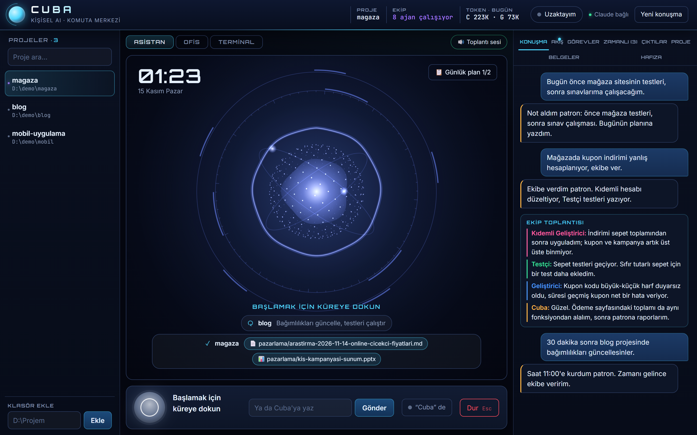
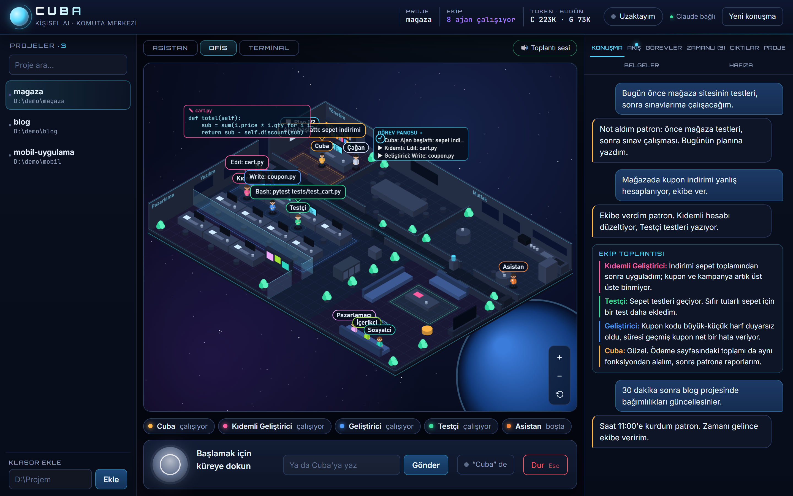
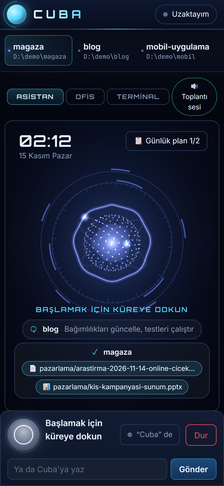
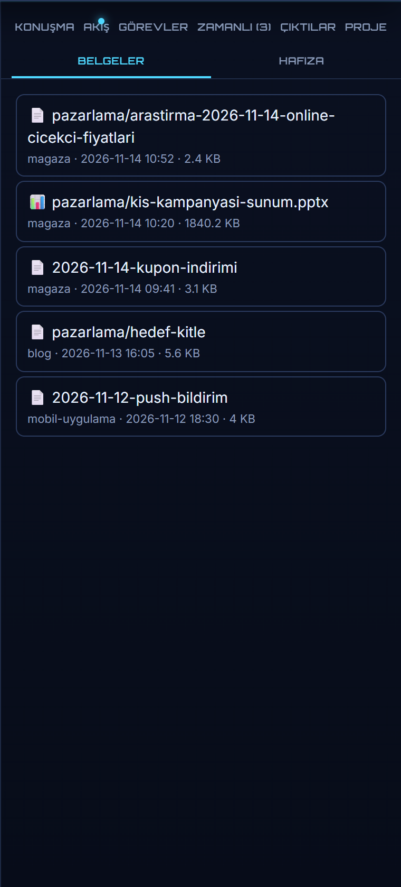
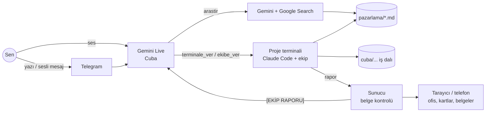

# Cuba: kişisel AI komuta merkezi

Cuba, sesle konuştuğun Türkçe bir kişisel asistan ve onun yönettiği bir yapay zekâ ekibi.

- **Konuşma Gemini Live'da:** telefonda konuşur gibi konuşursun, sözünü kesebilirsin, cevap yarım saniyede gelir.
- **İş Claude Code'da:** kod, araştırma, pazarlama ve sunum işlerini her projenin kendi terminalindeki Claude ekibi yapar.
- **Her şey ekranda:** ekip uzay istasyonundaki bir ofiste çalışır. Kim hangi dosyayı yazıyor, kim kiminle toplantıda, canlı görürsün.

Gündelik sohbet Claude token'ı harcamaz. Claude yalnızca gerçek bir iş verildiğinde çalışır.



| Ofis: ekip çalışırken | Telefondan |
|---|---|
|  |  |

> Görüntüler örnek verilerle `tools\screenshots.py` ile alınır. Gerçek konuşma ya da hafıza içermez.

## Neler yapar

**Konuşur ve hatırlar**
- Günün planını, görevleri, takvimi ve notları tutar. "Bugün ne vardı?" dediğinde hatırlar.
- Seni tanır: tercihlerini, projelerini, sevmediklerini bir deftere yazar ve ona göre davranır.
- Her günün sonunda günlüğünü yazar. Ertesi gün yarım kalanı kendisi hatırlatır.
- Spor, yol, uyku, yemek gibi gündelik konuları kaydeder. Hava durumu ve güncel bilgi için Google'da arar.

**İş dağıtır**
- "Mağazada kupon indirimi yanlış, ekibe ver" dediğinde işi o projenin terminaline verir ve sohbete devam eder.
- Kod işleri projenin kendisinde değil, ayrı bir iş dalında (`cuba/...`) yapılır. Beğenmezsen "at" dersin, proje bozulmaz.
- Ekip bitirince rapor gelir. Cuba sana bir iki cümleyle anlatır.
- İleri zamanlı işler kurar: "30 dakika sonra blogda bağımlılıkları güncellesinler."

**Araştırır ve belge üretir**
- Kısa sorular (hava, maç, fiyat) anında sesli cevaplanır.
- "Online çiçekçi fiyatlarını araştır" dediğinde Gemini Google'da araştırır ve belgeyi projenin `pazarlama\` klasörüne yazar. Claude token'ı harcanmaz.
- Site taraması, rakip analizi ve sunum (`.pptx`) gibi derin işleri Claude'daki pazarlama ekibi yapar.
- Biten işin belgesi küre altındaki kartta çıkar. Tıklayınca açılır.
- Sunucu, raporda adı geçen her belgenin diskte gerçekten olup olmadığını kontrol eder. Cuba olmayan bir belgeye "hazır" diyemez.

**Seni bulur**
- Ekran başında değilsen biten işler, toplantı kararları ve onay soruları Telegram'a gelir.
- Ekip yalnızca senin yapabileceğin bir adımda takılırsa (giriş, 2FA, UAC) telefonunda "Cuba arıyor" bildirimi çalar.
- Uzak modda kararları Cuba senin yerine verir. Döndüğünde "hoş geldin patron" deyip olanları özetler.

| Bütün projelerin belgeleri | Bir araştırma belgesi |
|---|---|
|  |  |

## Ekip

Dokuz kişilik bir ofis: sen, Cuba ve iki bölüm.

| Bölüm | Kim | Ne yapar |
|---|---|---|
| Yönetim | **Cuba** | Seni dinler, işi böler, ekibe verir, sonucu sana anlatır |
| Yazılım | Kıdemli Geliştirici, Geliştirici, Testçi, Asistan | Kod, mimari, test, küçük işler |
| Pazarlama | Pazarlamacı, İçerikçi, Sosyalci | Strateji, araştırma, metin, SEO, sosyal medya, sunum |

Gerekirse Cuba ekibe yeni bir uzman alır ("bir tasarımcı al"). En fazla dört yeni masa açılabilir.
Birden fazla kişi bir işte çalıştıysa iş bitince toplantı odasında konuşurlar. Toplantıyı sesli dinleyebilirsin.

| Konuşma ve ekip toplantısı | Zamanlı işler |
|---|---|
|  |  |

## Nasıl çalışır



- **Sunucu** (`server/`): FastAPI ve WebSocket. Gemini Live oturumunu, proje terminallerini, ofisi ve hafızayı yönetir.
- **Terminal:** her projenin kendi Windows terminali var ve içinde Claude Code çalışıyor. Ekip üyeleri Claude Code alt ajanları (`cuba-ekip` eklentisi). Hook'lar her araç çağrısını ofise yansıtır.
- **Arayüz** (`web/`): çerçevesiz, düz JavaScript. Ofis bir canvas çizimi. Telefonda ana ekrana eklenen bir uygulama (PWA) olarak da çalışır.
- **Talimatlar** (`ekip/`): Cuba'nın, terminal liderinin ve her çalışanın görev tanımı düz Markdown dosyaları.

## Kurulum

Gerekenler: Windows 10/11, Python 3.13, [uv](https://docs.astral.sh/uv/), giriş yapılmış [Claude Code](https://claude.com/claude-code) ve bir [Gemini API anahtarı](https://aistudio.google.com/apikey). İsteğe bağlı: klasik ses modu için NVIDIA ekran kartı (yerel Whisper).

```powershell
git clone https://github.com/caganderindere/Asistan-m.git D:\ClaudeSes
cd D:\ClaudeSes
uv sync --extra dev
Set-Content data\gemini_key.txt "<Gemini anahtarın>"   # ya da GEMINI_API_KEY ortam değişkeni
powershell -ExecutionPolicy Bypass -File tools\make_shortcut.ps1   # masaüstü kısayolu
```

## Kullanım

- Masaüstündeki **Cuba** kısayoluna çift tıkla (ya da `start.cmd`). Tarayıcıda `http://127.0.0.1:8765` açılır.
- **Küreye dokun** ve konuş. Ya da alttaki kutuya yaz. "Cuba" demen de yeter.
- **Dur** düğmesi ya da `Esc` her şeyi durdurur.
- Sol listeye proje klasörü ekle. Cuba projeleri adıyla tanır: "blog projesinde şunu yap."
- Ekranlar:
  - **Asistan:** küre ve süren işlerin kartları.
  - **Ofis:** canlı çalışan ekip.
  - **Terminal:** Claude Code'un kendisi.
- Sağdaki sekmeler:
  - **Konuşma** ve **Akış:** konuşma geçmişi ve ekibin canlı hareketleri.
  - **Görevler**, **Zamanlı** ve **Çıktılar:** açık işler, zamanlanmış işler ve biten işlerin özetleri.
  - **Proje:** açık projenin git durumu ve belgeleri.
  - **Belgeler:** bütün projelerin belge, araştırma ve sunumları, tarih sırasıyla.
  - **Hafıza:** Cuba'nın seninle ilgili defteri ve günlükleri.

### Belgeler nereye kaydedilir

| Ne | Nereye |
|---|---|
| Pazarlama belgeleri, araştırmalar, sunumlar | `<proje>\pazarlama\` |
| Kod işlerinin planı, test raporu ve sonucu | `<proje>\docs\ekip\` |
| Site taramasının ham verisi | `<proje>\pazarlama\veri\` |

## Ayarlar: `config.json` (isteğe bağlı)

```json
{
  "voice": "tr-TR-EmelNeural",
  "vocabulary": ["Çağan", "WordPress", "BalBal Medya"],
  "workdir": "D:\\",
  "port": 8765,
  "models": { "kidemli": "claude-opus-5-5" },
  "remote_hosts": ["pc.agin.ts.net"]
}
```

Yalnızca değiştirmek istediğin alanları yaz. `models` ile ekip üyelerinin modelini seçersin. `vocabulary`, ses tanımanın doğru yazması gereken özel isimlerdir. Cuba'nın canlı sesi Hafıza sekmesinden seçilir.

## Telefondan

**Canlı konuşma (Tailscale).** Bilgisayar evde açık kalır, telefon mikrofon ve hoparlör olur.

1. Bilgisayara ve telefona [Tailscale](https://tailscale.com/download) kur, ikisinde aynı hesapla gir.
2. Bilgisayarda bir kez: `tailscale serve --bg 8765`
3. Cuba'yı yeniden başlat. Pencerede `Telefondan: https://<bilgisayar>.<ağ>.ts.net` yazar.
4. Telefonda o adresi aç ve **Ana ekrana ekle**. Hafıza sekmesindeki **Telefonda bildirimleri aç** düğmesine bir kez dokun: "Cuba arıyor" bildirimleri böyle gelir.

Adres yalnızca senin Tailscale cihazlarından açılır, internete açık değildir.

**Telegram.** @BotFather'dan bir bot aç, token'ı `data\telegram.json` içine yaz (`{"token": "..."}`), Cuba'yı yeniden başlat ve ekrandaki kodla bota `/esle <kod>` gönder. Bundan sonra yazıyla ya da sesli mesajla Cuba'yla konuşabilirsin. Onay soruları Evet/Hayır düğmeleriyle gelir. Komutlar: `/durum`, `/uzak`, `/dur`.

## Gizlilik

- Canlı konuşmada ses Gemini Live'a (Google) gider. Klasik modda ses bilgisayardan çıkmaz, yerel Whisper yazıya döker.
- Cuba'nın hafızası, günlükleri ve Telegram mesajları Gemini'ye, ekibe verilen işler ve proje dosyaları Claude'a (Anthropic) gider.
- Sunucu yalnızca bu bilgisayardan ve kurduysan senin Tailscale cihazlarından erişilebilir.
- Belge penceresi yalnızca projelerin `docs\ekip\` ve `pazarlama\` klasörlerindeki belgeleri açar.
- Ekip tam yetkiyle çalışır ve çoğu işte izin sormaz. Klasör silme, `git push`, paket kaldırma ve canlıya dağıtım gibi riskli komutlar bir hook ile durdurulur ve senin onayını bekler.

## Sorun giderme

| Belirti | Çözüm |
|---|---|
| "Claude Code bulunamadı" | Bir terminalde `claude` yazıp giriş yap, Cuba'yı yeniden aç |
| "Mikrofon izni gerekli" | Adres çubuğundaki kilitten mikrofona izin ver |
| Cuba cevap vermiyor, "quota" hatası | Gemini anahtarının kotasını ve faturalandırmasını kontrol et |
| Telefonda adres açılmıyor | `tailscale serve status` ile yönlendirmeyi kontrol et |
| "Başka bir sekmede açıldı" | Uygulama tek sekmede çalışır, öbür sekmeyi kullan |

## Geliştirme

```powershell
.venv\Scripts\python -m pytest                     # birim testleri
.venv\Scripts\python -m pytest -m "network or gpu" # gerçek Edge sesi ve ekran kartında Whisper
.venv\Scripts\python -m pytest -m e2e -s           # gerçek Claude ile uçtan uca (uygulama kapalıyken)
.venv\Scripts\python tools\screenshots.py          # README görüntülerini örnek verilerle yeniden al
.venv\Scripts\python tools\tanitim.py              # tanıtım videosunu örnek verilerle kaydet
```

Görüntü ve video araçları Playwright ile Microsoft Edge'i kullanır ve tamamen uydurma verilerle çalışır.
